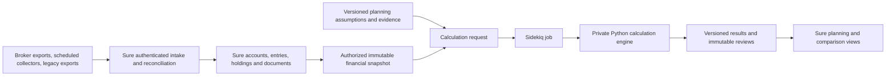

# Finance feature review and migration backlog

Reviewed October 25, 2026. This extends the [initial consolidation assessment](finance-consolidation.md).
The scope is the current local source of Sure, local-fin-app and local-fin-health,
not an inventory of their saved financial data. No changes to either source app
or its financial records were made. Review builds used disposable source copies;
health API/browser tests used temporary SQLite databases.

## Decision

Consolidate the product around Sure. Keep one authoritative ledger, account and
holdings store, one authorization layer and one market-data path. Bring forward
the health app's planning, evidence and review capabilities, initially retaining
its Python calculation engine. Selectively adapt portfolio research and cash-flow
forecasting from local-fin-app. Do not transplant both frontends or maintain three
editable copies of the same balances.

The demonstration accounts and native restore verification are complete. The next
implementation increment should define canonical data ownership and mapping,
then prove one automated snapshot ingestion path. Planning integration follows
reconciliation; it does not require rebuilding the health engine from scratch.

## Evidence and executable checks

| Application | Verification | Result and limits |
| --- | --- | --- |
| local-fin-app | Existing portfolio strategy assertions and API test/build script | Strategy assertions passed; 28 API regression tests passed. These exercise parsers, configuration and pure analytics/scheduling functions; they are not authenticated HTTP/database integration tests. |
| local-fin-app | API TypeScript and Next.js production builds | Passed using existing dependencies in a temporary copy. The local Node runtime was 26.12.1; the app's Docker configuration specifies Node 20, so deployment parity remains to be checked. |
| local-fin-app | Synthetic HTTP/database smoke check | API ran with Node 20 in a localhost-only container and a disposable PostgreSQL database. Preview did not write transactions; same-file replay replaced two rows and changed IDs; different-file overlap skipped both rows. A transfer exposed the account-balance discrepancy below. Projection, analysis, dated dashboard and dated report requests returned HTTP 200. |
| local-fin-health | Existing backend suite | 154 passed, with two dependency deprecation warnings. Coverage includes projection, provincial calculations, funding, holdings, evidence, revisions, scenarios, simulation and API backup/restore. |
| local-fin-health | TypeScript/Vite production build | Passed; Vite warned about the large generated JavaScript chunk. |
| local-fin-health | Existing Playwright suite | 16 passed, 1 failed. The broad household/review/scenario/import test expects 9 `.chart .recharts-line-curve` elements but gets 12. It stops there, so later actions in that test were not verified. Investigate selector scope and intended series before changing the expectation. |
| local-fin-health | Browser artifacts inspected | The synthetic-data Investments screenshot shows holdings editing, unknown cost-basis coverage, valuation freshness, allocation breakdowns, migration preview and net-worth history in one workflow. Browser tests also exercised evidence review, holdings migration, unsaved edits, retirement income and planning comparison. |
| Sure | Earlier baseline on the documentation branch | 13,433 tests, 61,843 assertions, zero failures/errors, 36 skips. Native backup restore and encrypted email lookup were verified in disposable server resources; the six labelled demo accounts reconcile to CAD 2,306,000. |

Tests establish regression evidence, not independent verification of tax tables,
broker compatibility or saved household inputs. No live brokerage integration or
ProjectionLab contract was exercised. local-fin-app's browser UI was not
exercised against the test backend; its API smoke check does not replace a full
end-to-end workflow test.

### Additional migration findings from synthetic API checks

With a cash account opening at 1,000, imported payroll of 1,000 and spending of
25, a subsequent manual transfer of 100 to a new zero-balance cash account
produced source/destination ledger postings of -100/+100. The `/accounts`
response reported source cash 1,875 but destination cash 0 rather than 100.
The destination posting exists; the cash balance read path needs investigation.
Do not migrate the discrepancy as a real missing asset or assume that current
API balance totals and mirrored postings always agree. This was reproduced only
with synthetic data; existing user records were not examined.

Same-filename CSV replay left two transactions but replaced their IDs, whereas
an overlapping file under another name inserted zero and skipped two duplicates.
Distinguish replacement semantics from stable identity: legacy transaction IDs
alone cannot guarantee continuity after a source reimport. Include this case in
the source identity and reconciliation contract.

## Feature decisions

Evidence identifiers resolve to the source map below. “Covered” means overlapping
capability exists in Sure, not identical behaviour or UI.

| Capability | Implemented evidence in local apps | Sure baseline | Decision |
| --- | --- | --- | --- |
| Accounts, manual balances and debt | A1/A2: cash, credit, loan accounts and dated balance anchors | S1: account types, ownership, opening/current valuations | **Use Sure.** Map anchors as valuations, never income. |
| Transactions, transfers and reconciliation | A1/A2: editable transactions, linked transfers, journal postings | S1: entries, paired transfers, reconciliation | **Use Sure.** Convert signs and preserve both transfer legs. |
| Double-entry representation | A1/A2: startup rebuilds mirrored postings from legacy transactions; analytics reads postings | Sure's existing entry/balance model | **Retire the duplicate ledger.** Migrate canonical operations, not both legacy rows and mirrored postings. |
| CSV and statement PDF intake | A1/A3: upload/preview, duplicate handling, PDF text conversion | S2: CSV/PDF import, preflight, statement archive | **Adapt source-specific parsing only.** Use fixtures to prove improvements over Sure's existing path. |
| Merchant rules and categorization | A1/A3: normalization, saved examples, deterministic rules and Ollama fallback | S3: rules, merchant detection, categorization actions | **Use Sure; migrate useful rules.** Do not copy provider clients or assume confidence scales are equivalent. |
| Recurring income, bills and transfers | A4: weekly/biweekly/monthly schedules, end date, skip/post-next and auto-post | S4: recurrence rules, occurrences, autopay, matching and recurring transfers | **Compare behaviour before porting.** Prove holiday/month-end dates and actual-versus-planned matching; an autopay flag is not proof of identical posting semantics. |
| Loan repayment outlook | A4: principal/interest split, current-balance payoff, negative-amortization reporting | S4: contractual schedule and live-balance payoff projection | **Use Sure first.** Add only demonstrated reporting gaps. |
| Spending and debt reports | A5: category/merchant breakdowns, overview, debt outlook, drill-down and Sankey | S5: reports, spending comparisons, cash-flow graph and investment reports | **Use Sure; adapt useful interactions.** Agree classification semantics before comparing totals. |
| Near-term cash forecast | A4/A5: 1/3/6/12-month horizons, historical baselines, recurring flows, cash-only and credit-pressure lenses | S5: bounded cash-flow comparisons and recurring projections; no equivalent combined forecast established in this review | **Adapt after ledger migration.** Keep forecast assumptions separate from posted transactions; unused credit is not cash. |
| FIRE/coast milestones | A6: client calculations, portfolio baseline, public-pension assumptions and saved preferences | No equivalent full planning workflow established | **Retire the duplicate engine.** Preserve useful milestone presentation in the health planning workflow; do not carry hardcoded benefit constants forward as authoritative data. |
| Holdings and account cash | A7 browser CSV/overrides; H1 native holdings and account cash | S6: holdings, trades, securities, native currencies and balance materialization | **Use Sure.** Preserve quantity and cash; a snapshot is not a purchase. |
| Allocation and concentration | H1/H2: account/asset-class/currency breakdown, normalized ticker concentration, filters | S6: security classification, holding weights and investment reporting | **Adapt missing insights.** Combine equivalent securities using exchange-aware identity, not just stripped ticker text. |
| Price/FX freshness and basis coverage | H1/H2: stale/unknown valuation value and missing cost-basis coverage | S6: price/FX providers and cost-basis provenance | **Preserve the health workflow where missing.** A recently saved checkpoint does not imply fresh prices. |
| Portfolio strategies and transition plans | A7: eight strategy presets, position caps, fee/account placement, glidepaths, proposed buys/trims and hypothetical deployments | No equivalent strategy workbench established | **Defer a separate analysis module.** Save assumptions and proposed changes without executing trades or modifying holdings. |
| Stock research and analyst export | A7: watchlist, quote/history requests, DCF inputs, diagnostics and sanitized JSON/Markdown analysis | Sure security data; no equivalent research workflow established | **Defer selectively.** Keep research assumptions and watchlists separate from verified positions. |
| Canadian deterministic retirement | H3: model 3.3.0, owner-specific cash flows, lifetime funding solvers, retirement-age frontier | Canadian account labels exist; no equivalent retirement engine established | **Integrate the Python engine first.** Pin fixtures, model version and numerical tolerances. |
| Canadian tax and benefits | H3/H4: registered account room/withdrawals, benefits, RRIF, pension splitting, survivor and estate paths | S6: account tax-treatment labels and reports | **Integrate supported calculations.** Labels are not statutory tax calculations. |
| Lifestyle and income-versus-spending comparison | H2/H3: spending profiles/phases, retirement ages, funded spending, shortfalls | No equivalent lifetime workflow established | **Migrate the workflow.** Preserve the distinction between gross withdrawals and spendable funding. |
| Housing, debt, insurance and events | H3/H4: downsizing, debt schedules, policy cash values/premiums/loans, surrender sensitivities and dated events | S1: current property/assets/debts; no equivalent planning contracts established | **Split ownership.** Sure stores current values; plans store future terms, benefits and scenarios. |
| Resilience and explainable scores | H2/H3: current/retirement components, thresholds, risks, margins and explanations | S3: financial insights; no equivalent resilience model established | **Migrate**, keeping scores distinct from simulation probabilities. |
| Scenarios and assumption sensitivities | H3: overrides, comparisons, fee/return/inflation/cash and policy surrender cases | No equivalent household lifetime comparison established | **Migrate.** Read-only calculations must not replace saved balances or tune inputs silently. |
| Exploratory Monte Carlo | H3: seeded 100–2,000 trials, default 500, time-bounded runs and confidence intervals | No equivalent engine established | **Integrate as a background job after deterministic parity.** Preserve actual completed trial count, seed and caveats; 5,000–50,000 trial background delivery remains roadmap work. |
| Planning evidence and confirmations | H5: source text, review checklist, dated confirmations/reopening and revision guards | S2: statement documents and reconciliation | **Migrate as separate evidence metadata.** A user's confirmation is not document verification and must not change balances. |
| Immutable reviews and calculation audit | H5: input/output snapshots, model version and reproduction checks | Sure's current ledger and histories are mutable | **Preserve separately.** Do not recreate old reviews from today's mutable data. |
| Backups and migration exports | A8 operational snapshots; H5 full/plan JSON and history exports | S7: full-instance backup and import/export infrastructure | **Use Sure operations, preserve original exports.** Browser state and old engine artifacts need explicit capture. |
| Access control and multi-household tenancy | Neither source app supplies Sure-equivalent family/account authorization | S1: sessions, roles, account owners/shares, API scopes | **Use Sure exclusively.** Do not proxy the existing unauthenticated APIs unchanged. |

## Data ownership and migration boundaries

| Data | Authoritative destination | Migration constraint |
| --- | --- | --- |
| Accounts, balances, liabilities, holdings, trades and transactions | Sure models | Stable source IDs scoped by source and household; reconcile one account/date at a time. |
| Security identity and market observations | Sure securities, prices and exchange rates | Preserve exchange, currency, date and provider; review collisions caused by legacy ticker normalization. |
| Spending, income and contribution targets | Versioned planning assumptions, optionally derived from Sure with an explicit review | Actual income history is not automatically a future salary; actual contributions are not room or future targets. |
| Person/beneficiary relationships | Explicit planning-person mapping linked to Sure owners when appropriate | Health currently supports one or two people and indexed owners 0/1. RESP beneficiaries and non-user people require explicit modelling; do not manufacture login accounts for them. |
| Tax room and adjusted cost bases | Separate verified planning/tax inputs with provenance | Broker book cost and Sure's holding cost basis do not by themselves establish Canadian tax ACB; preserve unknowns. |
| Strategy models, hypothetical trades and research | Separate analysis records | Never post a proposed buy/trim as a real trade or treat assumed capital deployment as cash already held. |
| Historical reviews and source evidence | Immutable planning history and private source archive | Retain original input/output and engine artifacts; model upgrades create new results rather than rewriting old ones. |

local-fin-app persistence is split: PostgreSQL holds operational accounts,
transactions, schedules, rules, examples, settings and aggregate portfolio
history; browser local storage holds detailed portfolio inputs, overrides,
assumptions, watchlists and potentially unmigrated history. Capture at least
`portfolio_analysis_inputs`, `portfolio_analysis_assumptions`,
`portfolio_analysis_snapshot`, `portfolio_analysis_total_history`, and
`portfolio_stock_research_watchlist`. FIRE preferences also appear in server
`ui_preferences`. Inspect actual exports before assuming complete backup coverage.

local-fin-health persists JSON documents for plans, scenarios, snapshots,
projection audit and valuation history. Retain full exports, not only a current
plan export. Legacy `SourceLink` and `net_worth_connection` schema fields remain,
but the inspected holdings-import path clears/disables them; their existence is
not evidence of a working live sync with local-fin-app.

Numeric contracts differ: local-fin-app uses integer cents; the health engine
uses floating-point planning values; Sure uses decimals and explicit currency
conversion. Use decimal strings at financial API boundaries, document unit/sign
conversion, and establish tolerances for engine parity. Preserve acquisition
currency and dates, not only a translated CAD balance. Avoid replacing existing
Sure classifications/metadata with weaker inferred values.

## Target architecture

The diagram describes proposed integration, not an implemented connection.
Keep the Python engine stateless per request: no shared global household plan,
no direct live-ledger writes and no public service port. Sure authorizes the
request and result access, enforces time/resource limits and records input hash,
schema/model/tax-table versions, date, seed and result status. Persist jobs and
results in Sure; package the engine as a pinned private service, with its source
and tests maintained alongside the integration after ownership/licence review.

Do not transplant the health app's global SQLite document API. Map stable IDs to
its indexed account/person references only inside an immutable calculation
request. Store planning-only data that Sure cannot currently represent without
forcing it into account balances. Identify missing fields explicitly.

## Prioritized delivery backlog

| Order | Increment | Acceptance criteria |
| --- | --- | --- |
| 1 | Canonical source/mapping contract | Synthetic fixtures specify owner/person, source account IDs, dates, currency, decimal units, sign conversion, account cash versus holdings, basis provenance and current-versus-planned values. Cover same-file replacement changing source IDs and disagreement between legacy balance responses and transfer postings. Every feature above has a disposition; unresolved mappings produce review items. |
| 2 | One unattended account/holdings snapshot | An authorized producer submits through existing Sure import/resource APIs, polls completion and reconciles totals without selecting a file in a browser. Preview is revision-bound; retries and overlapping batches do not duplicate records; cross-family/account access is denied. Demonstration aggregates cannot coexist in totals with their detailed replacements. |
| 3 | Legacy export and migration adapter | Capture backend and browser exports; migrate one account and compare opening/current balances, quantities and cash to a dated statement. Preserve original exports and import audit, and demonstrate a selective reversal strategy. No automatic deletion of the old apps. |
| 4 | Planning adapter and deterministic parity | Stable identity mapping, CAD valuation and complete assumptions produce matching fixed-fixture model outputs within agreed tolerances. Exercise benefits, two owners, debt, housing, policy values and unsupported cases. Engine cannot alter Sure balances. |
| 5 | Evidence, reviews and planning UI | Preserve review history and uncertainty, expose explanations and input dates, and reject stale edits/results. Confirm evidence without changing financial inputs. Repair the existing broad browser-test failure and cover the whole review/import journey. |
| 6 | Scenarios and simulations | Background jobs support bounded concurrency, timeout/cancellation, seed/version capture, stale-input handling and separately labelled deterministic/stochastic results. Quantify actual completed trials. |
| 7 | Short-term cash forecast and portfolio insights | Reconcile forecast to actuals without double-counting payments or scheduled payroll; add missing freshness, coverage and concentration views using Sure's providers. Keep liabilities, cash and available credit distinct. |
| 8 | Optional strategy/research workbench | Port selected presets/diagnostics only after the user workflow is defined. Hypothetical portfolios, DCF assumptions and analyst exports remain separate from the ledger. Retire the duplicate FIRE calculation engine. |
| 9 | Verified cutover | Parallel reports reconcile with explained differences; old apps become read-only, exports and historical engine artifacts are retained, and recovery includes planning data. Retire old services only after this gate passes. |

Sure already exposes CSV preflight, uploads/status/rows, chunked NDJSON import
sessions and holdings/trades/valuation APIs. Extend those where fixtures prove a
gap; do not create a competing generic ingestion subsystem. Existing session
and chunk identifiers protect transport retries, but mappings are session-scoped;
establish cross-batch source identity before claiming ongoing idempotent sync.
Changing upstream data and overlapping statements require an explicit correction
policy, not just a new file hash. Broker APIs/export availability still determine
how data reaches a collector. Direct ProjectionLab compatibility remains unverified.

## Constraints to retain during integration

- The health engine's current Canadian mode excludes Quebec and rejects corporate
  and spousal RRSP accounts. FHSA and segregated-fund guarantee mechanics are not
  established by its account schema. Do not silently map these to a supported
  type or imply that Sure's existing labels supply the missing calculations.
- Tax tables and benefits need a separate dated-source review before migration;
  this feature review did not certify statutory accuracy. Preserve the documented
  omissions around dividends, foreign credits, education distributions and other
  unsupported calculations.
- RESP retirement-funding exclusion and insurance current cash value versus
  future death proceeds must survive migration. Loans and insurance premiums
  need source terms; do not infer guarantees from an illustrative scenario.
- Original README/roadmap claims are not a release inventory: source declares
  model 3.3.0 while some health docs describe older versions. The double-entry
  scaffold document in local-fin-app also predates its current read paths.
- Preserve Sure's family/account authorization, `Current` session context,
  money/currency conventions, design system and API testing/documentation rules.

## Source map

Paths prefixed A/H are relative to the corresponding local app repository; S
paths are relative to Sure. These are implementation anchors for follow-up work.

| ID | Source |
| --- | --- |
| A1 | `local-fin-app/apps/api/src/index.ts`: account/transaction/import/settings/snapshot routes, ledger mirroring/rebuild and analytics wiring |
| A2 | `apps/api/src/{ledger-read-model,analytics-types}.ts`, `migrations/`: posting reads, account/transaction/snapshot shapes |
| A3 | `apps/api/src/{pdf-import,merchant-normalization}.ts`, related tests and categorization/import code in `index.ts` |
| A4 | `apps/api/src/{schedule-planning,schedule-runtime,analytics-builders,analytics-payloads}.ts`, `analytics-regression.test.ts` |
| A5 | `apps/api/src/report-builders.ts`, `apps/web/components/{projections-panel,reports-panel-sections,dashboard-sections,analysis-panel}.tsx` |
| A6 | `apps/web/components/fire-planner-panel.tsx`, `apps/web/components/ui-preferences.ts` |
| A7 | `apps/web/components/portfolio-analysis-panel.tsx`, `portfolio-analysis-panel.strategy.test.ts` |
| A8 | `apps/api/src/analytics-types.ts` snapshot types, `index.ts` snapshot routes and `apps/web/components/settings-panel-snapshots.tsx` |
| H1 | `local-fin-health/backend/app/{schemas/plan.py,services/investments.py,services/investment_quotes.py,api/routes.py}` |
| H2 | `frontend/src/{pages/Investments.tsx,pages/Overview.tsx,pages/LifestyleComparison.tsx,components/investments/InvestmentInsights.tsx,components/RetirementIncome.tsx}` |
| H3 | `backend/app/services/{projections,scoring,scenarios,simulations}/`, `planning_comparison.py`, corresponding backend tests |
| H4 | `backend/app/services/{canadian,taxes}/`, `docs/{CANADIAN,MODEL,MONTE_CARLO}.md` |
| H5 | `backend/app/{api/routes.py,models/records.py,schemas/plan.py}`, `frontend/src/components/PlanningEvidencePanel.tsx`, `backend/tests/test_{api,planning_evidence}.py`, `frontend/e2e/` |
| S1 | `app/models/{account,entry,transfer}.rb`, `account/{opening_balance_manager,current_balance_manager}.rb`, `current.rb` |
| S2 | `app/models/{import,import_session,import_source_mapping,sure_import,account_statement}.rb`, `app/controllers/api/v1/{imports,import_sessions}_controller.rb` |
| S3 | `app/models/rule/action_executor/`, `app/models/insight/`, `app/controllers/insights_controller.rb` |
| S4 | `app/models/{recurring_transaction,recurring_occurrence}.rb`, `app/models/loan/{amortization_schedule,payoff_projection}.rb`, recurring controllers/tests |
| S5 | `app/controllers/reports_controller.rb`, `app/models/income_statement/{cash_flow,cash_flow_graph}.rb`, reports views/tests |
| S6 | `app/models/{investment,security,holding,trade,exchange_rate}.rb`, provider interfaces and investment reports |
| S7 | `bin/sure-backup`, `docs/hosting/docker.md` |
